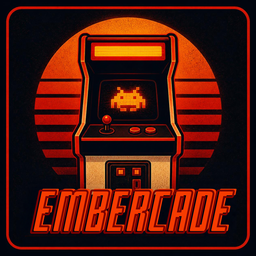
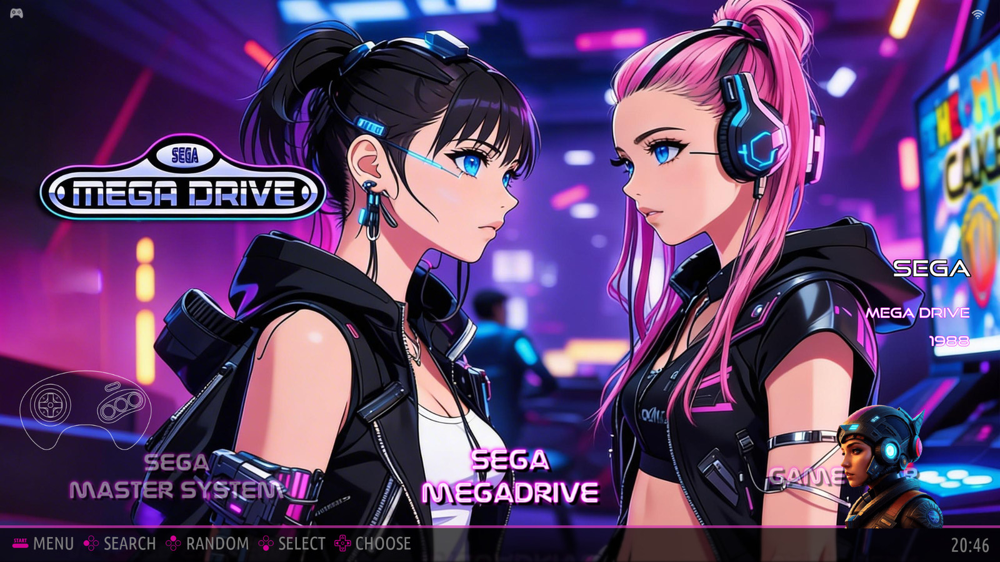
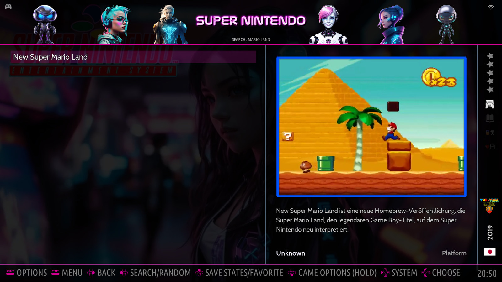
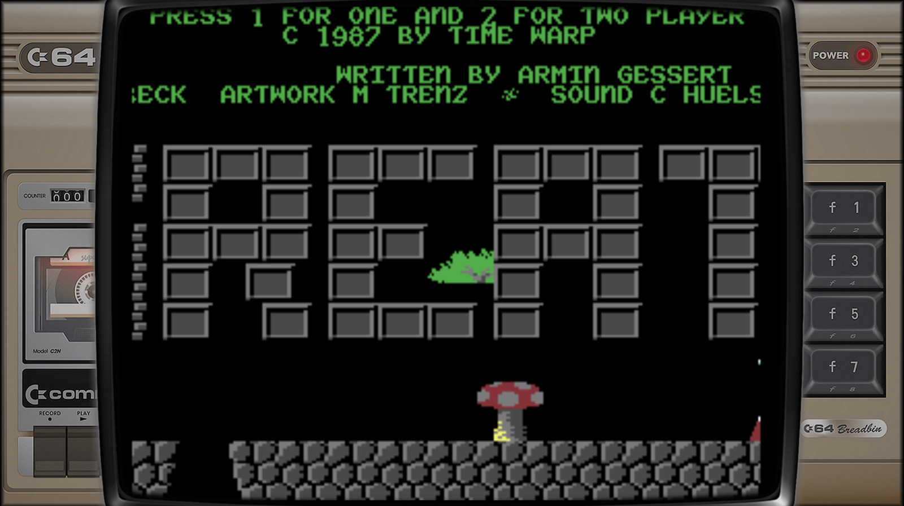
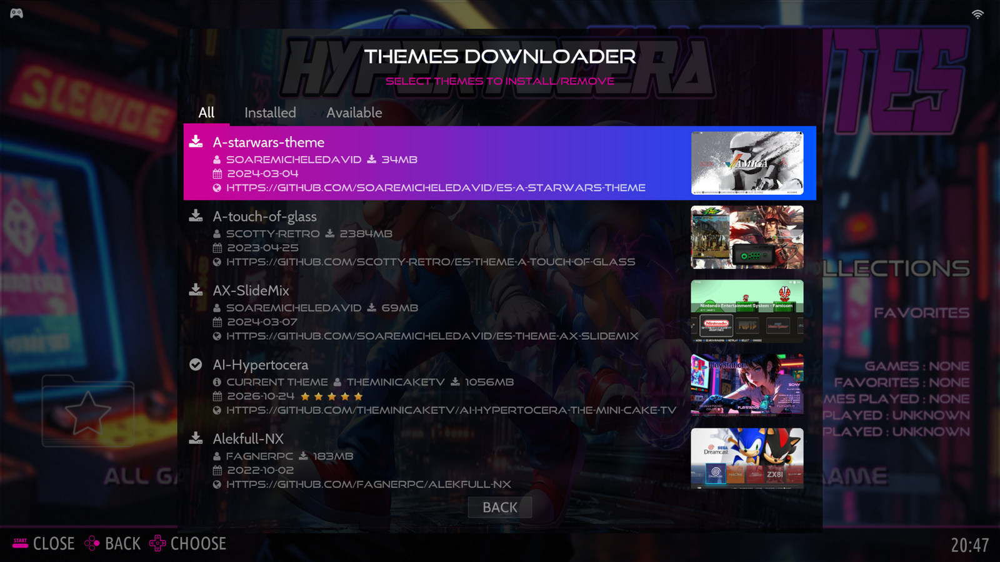
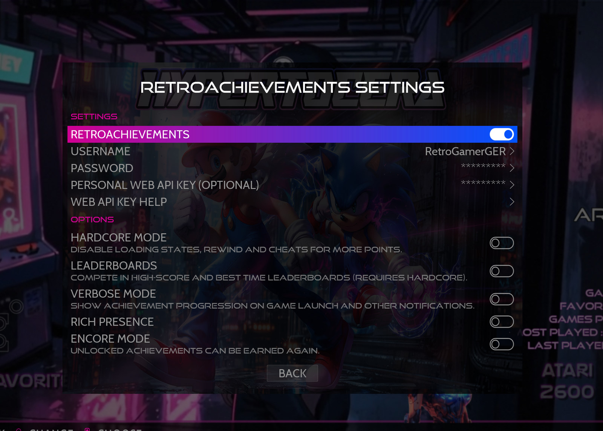
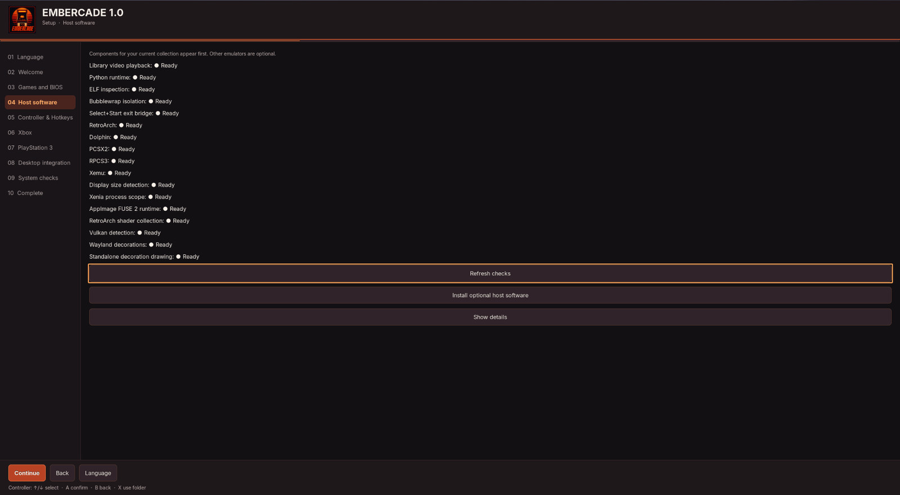
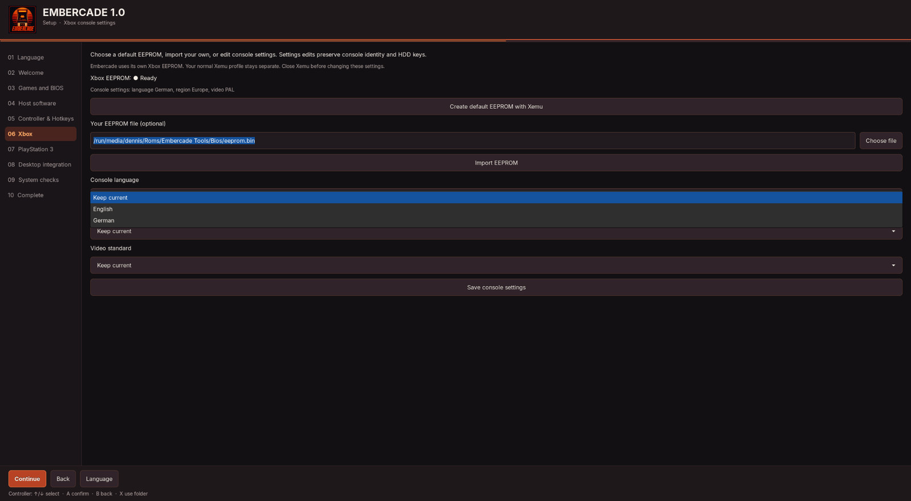

<p align="center">
  
</p>

<h1 align="center">Embercade</h1>


<p align="center"><strong>Your retro games. Your Linux desktop.</strong></p>

Embercade brings the console-style experience of Batocera and RetroBat to your existing Linux desktop. Browse your collection with a controller, launch a game and return to your library or desktop when you're done. No separate gaming operating system or dual boot required.

**[Download Embercade 1.0](https://github.com/RetroGamerGER/Embercade/releases/tag/v1.0.0)** · [Getting started](docs/GETTING_STARTED.md) · [Supported systems](docs/COMPATIBILITY_1_0.md)

## Why I created Embercade

After switching from Windows to Linux, there was one thing I really missed: **RetroBat**.

I loved having my games, artwork, videos and emulators together in one place. Batocera offered much of that experience, but I wanted to use it without leaving my regular Linux desktop.

So I started building Embercade.

What began as something I wanted for my own computer eventually became a project I wanted to share with other Linux users.

**Embercade isn't intended to replace Batocera, RetroBat or ES-DE.** It's another way to enjoy retro gaming on Linux, built on work from the communities behind these projects.

## What Embercade offers

### 🎮 Your games in one place

Browse your collection through Batocera's EmulationStation frontend using a controller. Embercade supports RetroArch/Libretro and a range of standalone emulator routes, including Dolphin, PCSX2, RPCS3 and Xemu. Actual compatibility depends on the game, emulator and your installed software.

### 🖼️ ScreenScraper integration

A game library feels better when it's more than a list of filenames. ScreenScraper can add artwork, descriptions, screenshots, videos and other information right from the frontend.

Already using RetroBat or Batocera? Embercade can reuse compatible `gamelist.xml` files and their existing media, provided the referenced paths remain accessible on Linux. **You don't have to scrape everything again.**

### 🏆 RetroAchievements

Sign in with your RetroAchievements account to earn achievements in supported emulators. You can also view your profile, achievement lists and progress directly in the frontend by entering your **own optional Web API key**.

Emulator achievements continue to use the normal player login; a Web API key is only needed for the additional frontend views. Embercade doesn't distribute a shared personal key.

### 🎨 Themes, bezels and shaders

- **Theme Downloader:** Browse, preview and install community themes from within EmulationStation.
- **Console decorations:** Select from the official RetroBat bezel collection where supported.
- **Shaders:** Choose optional effects from your host's `libretro-shaders-slang` package. Effects are off by default.

Embercade includes **Carbon** as its default theme. You can download another look whenever you like.

### 🖥️ Stay on your Linux desktop

Start Embercade from your desktop or add it to Steam, complete with library artwork. Play with a controller and return to EmulationStation when you're done. Embercade keeps its managed settings and saves separate from your normal emulator profiles where supported.

### 🛠️ Guided setup

The English/German setup wizard helps you configure game and BIOS folders, controller shortcuts, optional host software and desktop integration. You supply your own legally obtained games, firmware, emulators and Libretro cores; Embercade does not bundle them.

## Screenshots

These are screenshots from a real Embercade 1.0 installation — not mockups.

**Theme shown:** Most frontend screenshots use **AI-Hypertocera**, an optional community theme available through Embercade's built-in **Theme Downloader**. The included default theme is **Carbon**.

### Browse consoles and games



*Choose a system with your controller.*



*Browse your games with artwork, descriptions, videos and metadata.*

### Console decorations



*Great Giana Sisters with a Commodore 64 decoration from the RetroBat collection.*

### Themes and achievements

| Theme Downloader | RetroAchievements |
| --- | --- |
|  |  |
| Download and switch community themes. | Use your account and optionally add your own Web API key for frontend progress views. |

### Setup wizard

| Host-software checks | Optional Xbox setup |
| --- | --- |
|  |  |
| Check host requirements and offer optional software. | Configure a separate Xbox profile and import or create EEPROM data. |

## Download and installation

**[Get Embercade 1.0 and matching sources](https://github.com/RetroGamerGER/Embercade/releases/tag/v1.0.0)**

Embercade targets **x86-64 Linux**. The updated installer candidate accepts **Arch-based distributions with pacman**, including Arch Linux, CachyOS, Garuda and EndeavourOS. It checks `ID` and `ID_LIKE` in `os-release`, uses only your configured package sources and asks before installing anything. Fedora, Debian and Ubuntu are not enabled for automatic Pacman installation.

**Candidate status:** these installer changes are local test changes; the linked public 1.0 release has not been replaced. EndeavourOS detection is covered by automated tests, not a new full installation or gameplay acceptance.

PSP and Xbox system files are optional during general setup. Leave their fields empty or choose **Skip for now**; add complete system-specific files later when you want to use those systems. Existing working settings are kept.

The tested environments include **Garuda KDE Plasma/Wayland** and **CachyOS Handheld Edition with Steam/Gamescope**. This is not a guarantee of compatibility with every GPU, distribution or game.

The AppImage requires **CPython 3.14 at `/usr/bin/python`** and compatible host libraries. Please check the [system requirements](docs/APPIMAGE.md#bundle-and-host-boundary) before starting.

Download the AppImage, then run:

```sh
chmod +x Embercade-1.0-x86_64.AppImage
./Embercade-1.0-x86_64.AppImage
```

For first-time setup, checksums, updates and uninstall instructions, see [Getting Started](docs/GETTING_STARTED.md).

### Known limitation: 16:10 bezels

Some decorations designed for 16:9 displays may be cropped or incorrectly aligned on 16:10 screens. This was observed on the test laptop in both RetroArch and standalone emulators. The issue is documented and isn't yet fixed. You can disable the decoration using **Decoration → None**.

For detailed system coverage, see [Compatibility 1.0](docs/COMPATIBILITY_1_0.md).

## A special thank you to the community ❤️

Embercade wouldn't exist without the developers, artists and communities who have spent years making retro gaming possible. I want to give special thanks to:

**Batocera** — For EmulationStation, the launcher, the configuration system and the incredible amount of work behind the project.

**RetroBat** — For inspiring Embercade, sharing its console decoration collection and creating the experience I missed after moving to Linux.

**EmulationStation, Libretro and RetroArch** — For their contributions to bringing different emulators and classic games together.

**ScreenScraper** — For the artwork, videos and game information that bring game libraries to life.

**RetroAchievements** — For adding achievements, challenges and progress tracking to the games we grew up with.

**The artists behind the bezels 🎨** — A very special thank you to the people who created console decorations for the retro gaming community. This includes artists such as **Duimon**, along with many other talented contributors. Not every original artist can be identified by name from the available historical records, but that makes their contribution no less valuable. Embercade preserves existing credits, watermarks and applicable notices. If your work is missing proper attribution, please [open an issue](https://github.com/RetroGamerGER/Embercade/issues) so it can be reviewed and corrected.

**Theme creators, emulator developers and community contributors** — Thank you to everyone who shares themes, builds emulators, tests software, writes documentation and helps others enjoy retro gaming.

**Embercade may be my project, but it wouldn't be possible without all of you. Thank you! ❤️**

## Licensing and source code

Embercade is a **free, non-commercial, source-available community project**. Its independently developed client code uses **PolyForm Noncommercial 1.0.0**. Original Embercade documentation and branding use **CC BY-NC-SA 4.0** for rights held by the project owner.

Third-party software and artwork retain their own licenses and permissions. The AppImage does not have a single blanket non-commercial license, and the project's terms do not change the commercial-use rights granted by GPL, LGPL, MIT or other upstream licenses. PolyForm Noncommercial is **not** an OSI-approved open-source license.

The complete matching source and third-party notice archive is available alongside the AppImage download.

- [License assignment](docs/LICENSING_1_0.md)
- [Third-party credits and notices](THIRD_PARTY_NOTICES.md)
- [Sources and rebuild information](docs/SOURCE_ACCESS.md)
- [Development roadmap](ROADMAP.md)

Embercade is independent and is not affiliated with or officially endorsed by Batocera, RetroBat, RetroAchievements or the other projects mentioned here.

---

*Made with a love for retro gaming and Linux.* 🐧
