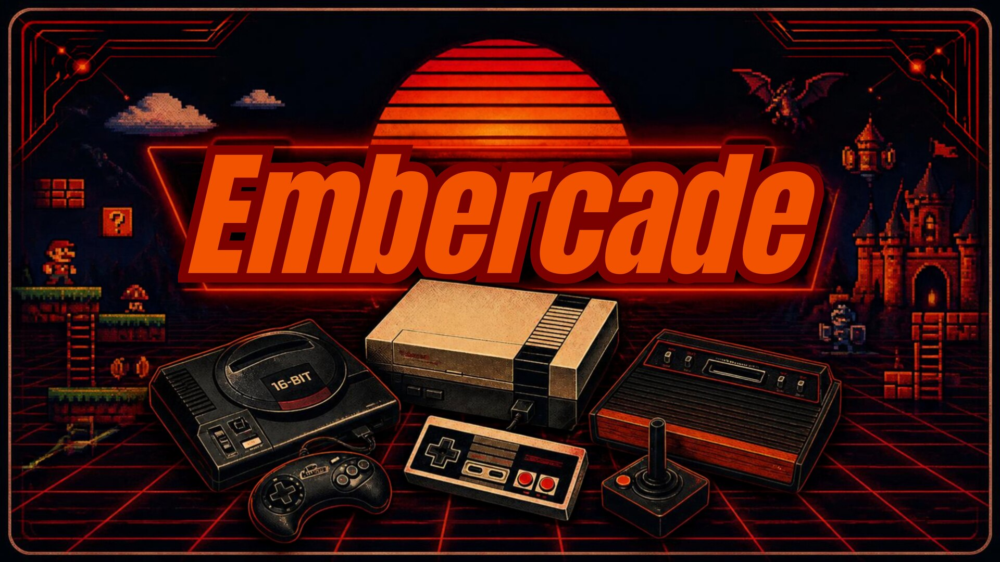

# Embercade

**A console-style home for your retro games, right on your Linux desktop.**

Embercade brings Batocera's EmulationStation frontend and launcher to your
existing Linux installation. Pick a game with your controller, play it in an
emulator, and return to your library when you're done. Your desktop and usual
applications stay where they are, without a separate gaming OS or dual boot.

I started Embercade because I missed the simplicity of RetroBat after switching
to Linux.

**Embercade 1.0 is prepared for public release, with no public download yet.** See
[licensing](#credits-and-licensing) for the current release status.

## What you can do

- Browse a controller-friendly library with descriptions, artwork and videos
  through ScreenScraper.
- Already using RetroBat or Batocera? Reuse compatible `gamelist.xml` files,
  game metadata and artwork without scraping everything again, as long as the
  referenced paths remain valid on Linux. See [library reuse](docs/GETTING_STARTED.md#reuse-a-retrobat-or-batocera-library).
- Use RetroArch/Libretro or standalone emulators, including Dolphin, PCSX2,
  RPCS3 and Xemu, on the supported system routes.
- Choose shaders, including NewPixie, and console bezels where supported.
- Browse, preview and install themes through the Theme Library.
- Set up game folders, BIOS paths and optional imports with an English or
  German setup wizard.
- Choose Back/Select + Start or Guide + Start to leave a game and return to
  the frontend, subject to your controller setup.
- Add Embercade to Steam with matching library artwork.
- Keep Embercade settings and saves separate from your usual emulator profiles.

You supply your own legally obtained games, BIOS/system files and separately
installed emulators or cores. None of those files are bundled. Embercade does
not modify the ROM or BIOS files themselves. It can update `gamelist.xml` and
save scraped media in the designated folders within your game collection.

## Where it runs

Embercade is developed and tested on **x86-64 Linux**:

- **Garuda Linux, KDE Plasma / Wayland** — the current MainRig desktop setup.
- **CachyOS Handheld Edition, Steam / Gamescope** — the living-room setup.

The owner also accepted the **Garuda KDE laptop with an NVIDIA RTX 4080**,
with the known 16:10 bezel limitation below. These results cover the listed
setups, not every GPU or Linux distribution.

**The current installer supports Arch Linux, CachyOS and Garuda only.** It uses
`pacman` for automatic host-software installation. Other distributions are not
currently supported; other Arch derivatives are not automatically enabled.

The current AppImage requires **CPython 3.14 at `/usr/bin/python`** from your
Linux installation, plus compatible desktop libraries. Python is not bundled;
see the [host requirements](docs/APPIMAGE.md#bundle-and-host-boundary).

Game compatibility depends on the emulator, core and title. The
[compatibility notes](docs/COMPATIBILITY_1_0.md) show what has been tested
and what still needs checking.

**Bezels on 16:10 displays:** Some of the current 16:9 artwork can be cropped
or fail to line up with the game area. This was observed at 2560×1600 on the
test laptop in both RetroArch and standalone Xbox/PS2 emulators. Correct 16:10
bezel presentation is not yet validated. You can disable the frame using the
existing **Decoration → None** setting. This limitation does not invalidate
the working 16:9 setups. See the [investigation](docs/LAPTOP_STANDALONE_BEZELS.md).

## Getting started

Place the AppImage in a local folder, make it executable and
open it. The wizard walks through game and BIOS folders, emulator requirements,
controller shortcuts and optional desktop or Steam integration.

Embercade installs in your user account. Optional host package installation is
a separate step that asks for confirmation; it supports Arch, CachyOS and
Garuda. Doctor helps you check what is missing.

See [Getting started](docs/GETTING_STARTED.md) for commands, checkout
installation, updates and removal, or [AppImage details](docs/APPIMAGE.md)
for build requirements.

## See it in action

*Demo video: to be added after recording.*

*Screenshots: library view, setup wizard and an in-game view to be added.*

<!-- Replace these notes with actual screenshots and the recorded demo link. -->

## A simple rule

> If you can still walk into a store and buy the console new, Embercade is not meant to replace it.

The focus is older consoles and computers, preservation, and your legally
obtained classics. This is the project's philosophy, not a legal classification.

## More details

- [System compatibility](docs/COMPATIBILITY_1_0.md) and the
  [historical 0.1 matrix](docs/COMPATIBILITY_0_1.md)
- [Controller setup](docs/CONTROLLER_SETUP.md) and
  [Steam integration](docs/STEAM_INTEGRATION.md)
- [ScreenScraper setup](docs/SCREENSCRAPER.md), the
  [production-build fix](docs/SCREENSCRAPER_PRODUCTION_FIX.md) and the
  [RetroArch startup fix](docs/RETROARCH_STARTUP_FIX.md)
- [Architecture](docs/ARCHITECTURE.md), [installation internals](docs/PRODUCTION.md)
  and [pinned upstream components](docs/UPSTREAM.md)
- [Roadmap](ROADMAP.md) and [technical project state](docs/PROJECT_STATE.md)

## Credits and licensing

Thanks to Batocera, EmulationStation, Libretro and the emulator, theme and
artwork authors whose work makes this possible. Embercade is independent,
with no affiliation or endorsement from those projects or console manufacturers.

Embercade is intended to stay a **free, noncommercial community project with
publicly readable source**, without paid editions or a separate commercial
license. The original independent Embercade client is licensed under
**PolyForm Noncommercial 1.0.0**; original documentation uses **CC BY-NC-SA 4.0**.
This is a **non-commercial source-available** software model. The exact grant
and exclusions are in [LICENSE](LICENSE) and the [license assignment](docs/LICENSING_1_0.md).
The owner-created Canva AI branding has a [documented origin](docs/BRANDING_ORIGIN.md);
its CC grant covers rights actually held, without claiming exclusive AI copyright.

The separately executed backend and original upstream integration contributions
use MIT-compatible terms. Batocera-team LGPLv3 code, explicitly GPL Configgen,
MIT EmulationStation and every other third-party component retain their actual
licenses and commercial permissions. The AppImage has no single blanket NC
license. See the [Batocera component distinction](docs/BATOCERA_COMPONENT_LICENSES.md).

The current private image uses the official RetroBat decoration collection,
with its published project basis and individual credits/notices preserved.
The full Libretro shader collection comes from the optional official
`libretro-shaders-slang` host package under its original terms; effects stay
off until selected. Only Carbon is bundled; downloaded themes retain their
own terms. See [resources and coverage](docs/RETROBAT_AND_HOST_SHADERS.md).

The current private candidate has been accepted by the owner on MainRig,
EmbercadeLaptop and WohnzimmerPC. The known laptop 16:10 bezel cropping/proportion
issue remains; see [acceptance and limitations](docs/PRIVATE_DEPLOYMENT_2026_10_28.md#owner-acceptance--28-october-2026).
[Prepared release notes](docs/PUBLIC_RELEASE_1_0.md) describe the downloadable
files, requirements and known limits. Public delivery still requires explicit
publication approval. Matching
sources and notices are [prepared locally](docs/THIRD_PARTY_DELIVERY.md); the
eventual public build must include them and be offered with its matching source
kit. [Personal RetroAchievements Web API keys](docs/RETROACHIEVEMENTS_USER_KEYS.md)
are optional for frontend views; normal emulator login is retained. The earlier
missing branding-origin entry is resolved.
No public release or push has occurred. See [third-party notices](THIRD_PARTY_NOTICES.md),
[source access](docs/SOURCE_ACCESS.md) and the [current release audit](docs/PUBLIC_RELEASE_AUDIT.md).
