# Getting Started with Embercade 🎮

Welcome to Embercade!

This guide follows **Embercade v1.0.1**. The older v1.0.0 download does not include the updated optional-file step and broader Arch-family detection.

This guide will help you download, set up and start Embercade on your Linux desktop.

**You don't need to be a Linux expert.** Most steps can be completed using your mouse and the built-in setup wizard.

We'll use KDE Plasma and the Dolphin file manager for the examples. Other desktop environments have similar options.

---

## 1. Before you begin

**Installer supports Arch-based Linux distributions.**

It uses Pacman to install missing system software. You don't need to configure additional repositories just to start the setup wizard.

Before downloading, make sure you have:

- A 64-bit Linux computer (x86-64).
- An Arch-based Linux distribution with Pacman.
- Python 3.14 available as `/usr/bin/python`.
- A working graphical desktop.
- Folders for your games and BIOS files, or somewhere to create them.

Embercade also needs some Linux system libraries. Graphical setup needs GTK3/PyGObject; the runtime uses Bubblewrap. See the [full host requirements](APPIMAGE.md#bundle-and-host-boundary). The wizard can check many additional components once it opens.

**Important:** Python 3.14 is required to start the current AppImage. If your system has a different Python version, Embercade may not launch. Python is not included in the AppImage.

You provide your own legally obtained games, BIOS/firmware files and compatible emulators. They are not bundled with Embercade.

## 2. Download Embercade

Open the official GitHub release page:

**[Download Embercade v1.0.1](https://github.com/RetroGamerGER/Embercade/releases/tag/v1.0.1)**

Find the latest release and download the file ending in:

`-x86_64.AppImage`

Save it in your **Downloads** folder or another location you can easily find.

An AppImage is a portable Linux application. You don't have to extract it or run a traditional installer before opening it.

You may also see source archives, manifests and checksum files on the release page. These are provided for source access and verification; you don't need to extract them to start Embercade.

## 3. Allow the AppImage to run

Linux may require you to mark a downloaded AppImage as executable before opening it.

### Using Dolphin (KDE Plasma)

1. Open Dolphin and find your downloaded Embercade AppImage.
2. Right-click the file and choose **Properties**.
3. Open the **Permissions** tab.
4. Enable **Allow executing file as program**.
5. Click **OK**.

[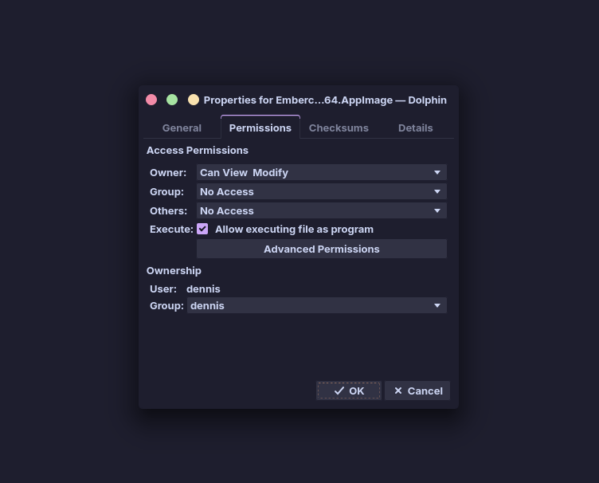](images/getting-started/dolphin-permissions.png)

That's it! You can now start Embercade by double-clicking the AppImage.

### Using GNOME or another desktop?

In GNOME Files (Nautilus), right-click the AppImage, open **Properties** and look for the permission to execute the file as a program.

Other Linux file managers provide similar settings. Their exact labels may differ.

**Prefer the terminal?** You'll find the command-line alternative at the end of this guide.

---

# Setting up Embercade

When you start Embercade for the first time, its setup wizard will help you configure your game library and system requirements.

You can return to the wizard later to change your settings.

## 4. Choose your language

[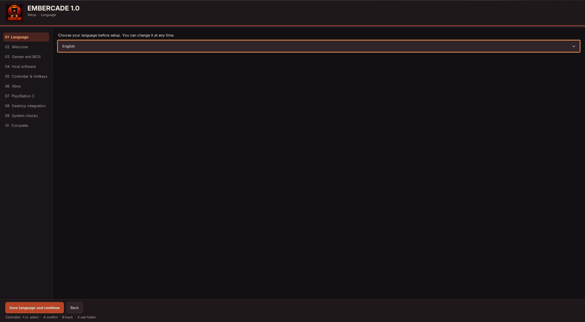](images/getting-started/language.png)

Select **English** or **Deutsch**, then click **Save language and continue**.

You can change the language later.

The next screen welcomes you and starts the setup process. Choose **Begin setup** to continue.

## 5. Choose your games and BIOS folders

[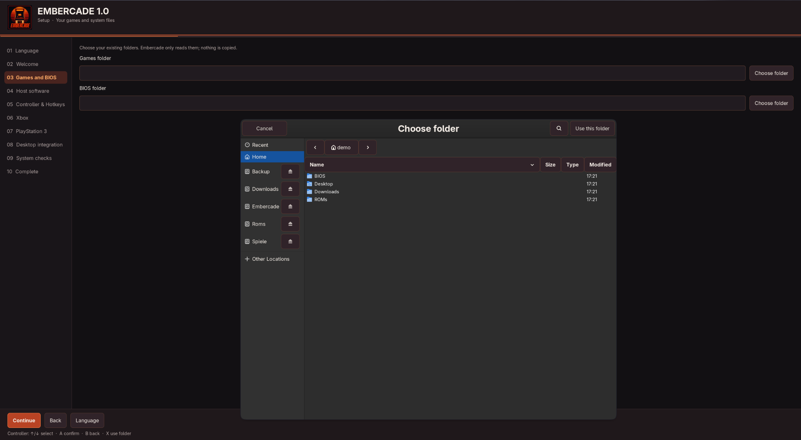](images/getting-started/games-and-bios-folder-picker.png)

Embercade needs to know where your games and system files are stored.

Click **Choose folder** next to each field:

**Games folder**

Select the main folder containing your retro game collection. This can be on an internal drive, external SSD or another accessible location.

**BIOS folder**

Select the folder containing your BIOS and firmware files.

If you haven't created these folders yet, you can create them using your file manager. Both folders must exist and be readable, but they don't need to contain files for every console.

**Your collection stays where it is.** Embercade doesn't copy your games or BIOS files during this step.

If you already have a collection from RetroBat or Batocera, Embercade can reuse compatible `gamelist.xml` files and existing artwork, as long as their paths work on Linux.

Embercade won't rewrite your ROM or BIOS contents. However, its scraping features can update `gamelist.xml` and save downloaded media in the selected game collection.

Click **Continue**.

## 6. Additional emulator files (optional)

[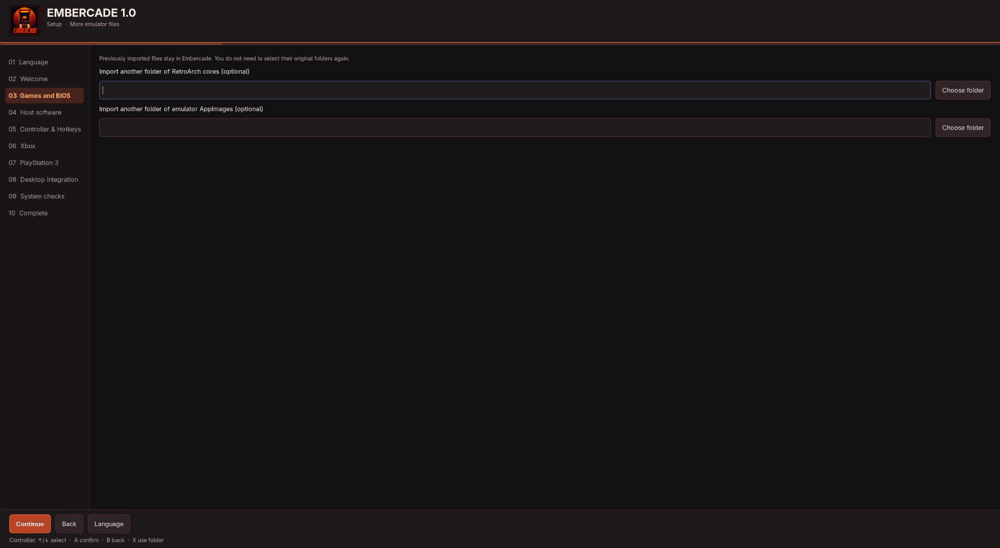](images/getting-started/extra-emulator-files.png)

You may see options to import additional RetroArch cores or emulator AppImages.

These are **optional**.

If you've already installed compatible emulators through your Linux package manager, you may not need to import anything.

If you have additional supported emulator files, select their folder. Embercade can manage its own copy while preserving the original files.

You may also see an optional **shadPS4 AppImage** selection.

[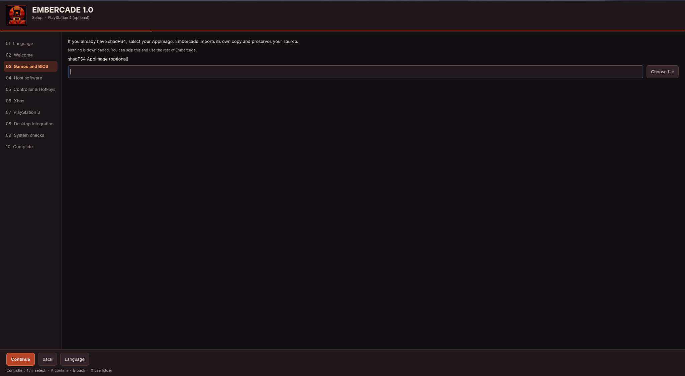](images/getting-started/optional-shadps4.png)

If you don't use shadPS4 or don't have its AppImage, leave the field empty and click **Continue**.

## 7. PSP and Xbox system files (optional)

[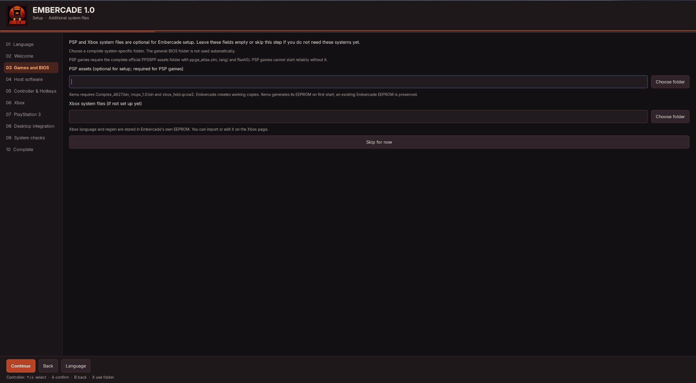](images/getting-started/optional-psp-xbox.png)

Some systems require additional files before their games can run.

For example:

**PSP:** Requires the appropriate PPSSPP assets folder.

**Original Xbox:** Requires compatible system files for Xemu.

You don't need to configure these systems unless you want to use them.

If you already have the correct files, choose their folders. Make sure you select the appropriate system-specific folder, not simply a general BIOS directory.

Otherwise, select **Skip for now**.

You can add the missing files later. Skipping this step doesn't prevent you from playing games on other systems or remove existing settings.

## 8. Check your system software

[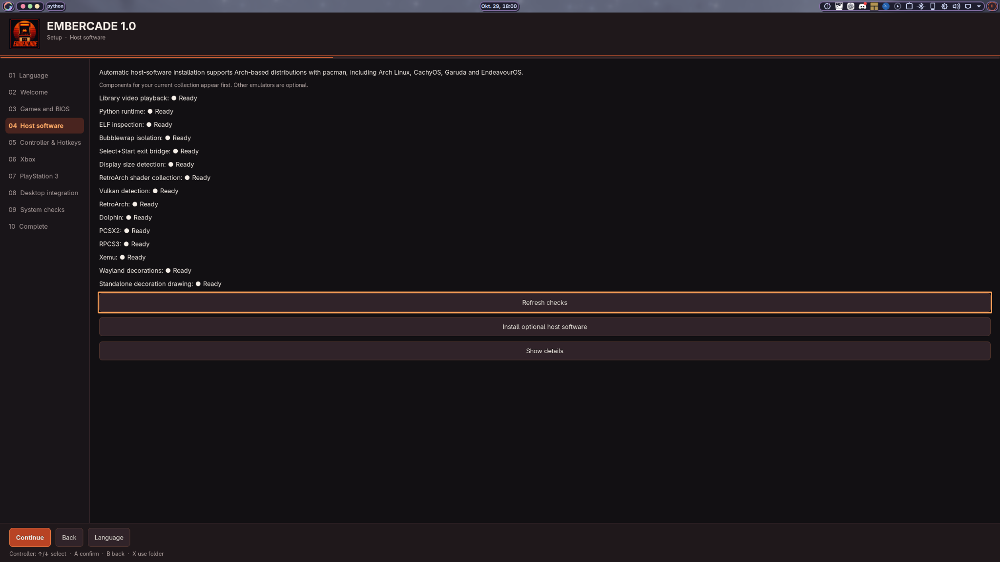](images/getting-started/host-software.png)

Embercade now checks the software needed for your game collection.

You'll see different status labels:

- **Ready:** The component was found.
- **Optional:** The component isn't required for your current setup.
- **Setup required:** Something needed for a selected function is missing.

Click **Refresh checks** if you've installed new software.

If required software is missing, choose **Install optional host software** to review the available installation options.

Embercade checks your existing Pacman repositories and can use supported existing AUR helpers.

**Nothing is installed without your confirmation.** A terminal window may appear to show the package installation and request your approval or administrator password. You don't need to enter package installation commands yourself.

### Optional tip: Chaotic-AUR

If you use [Chaotic-AUR](https://aur.chaotic.cx/), some community packages are available as prebuilt binaries.

This can save installation time because those packages don't need to be compiled locally.

Chaotic-AUR is completely optional. Embercade doesn't install or configure additional repositories or AUR helpers automatically.

Packages unavailable through your configured sources will be reported instead of silently installed from somewhere else.

Click **Continue** when you're ready.

## 9. Set up your controller

[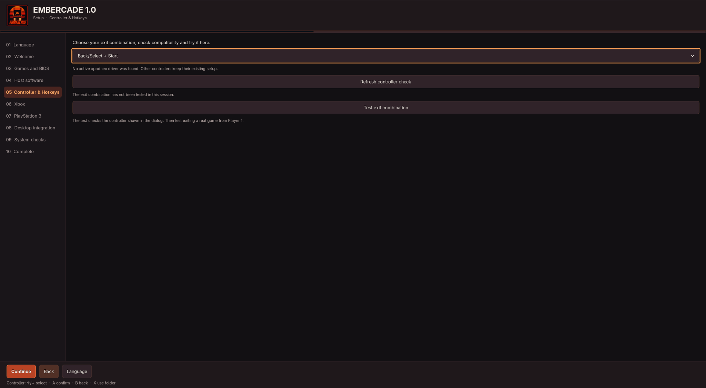](images/getting-started/controller-hotkeys.png)

Embercade is designed to be used with a controller.

On this page, choose the button combination you'll use to return from a game to Embercade.

Available options include:

- **Back/Select + Start**
- **Guide + Start**

The Guide-button option can depend on your controller and its Linux driver.

Use **Test exit combination** to check the detected controller. The wizard can also report when additional controller compatibility setup is needed.

If you're unsure, start with **Back/Select + Start**.

You can change this setting later.

Click **Continue**.

## 10. Xbox and PlayStation 3 setup (optional)

These pages are only important if you want to play games for those systems.

**Original Xbox**

[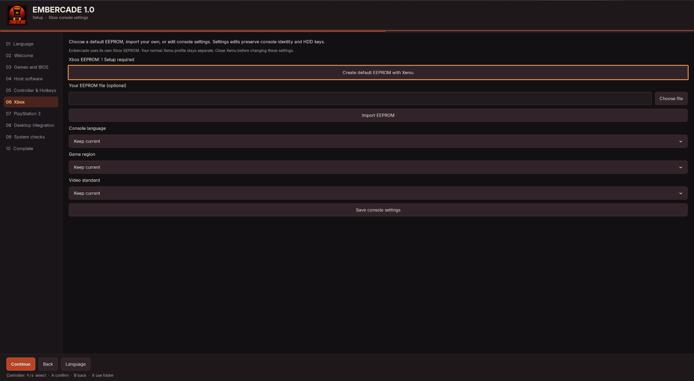](images/getting-started/xbox-settings.png)

Embercade offers options for an isolated Xbox EEPROM, console language, game region and video standard.

You can configure the Xbox environment later if you don't need it right now.

**PlayStation 3**

[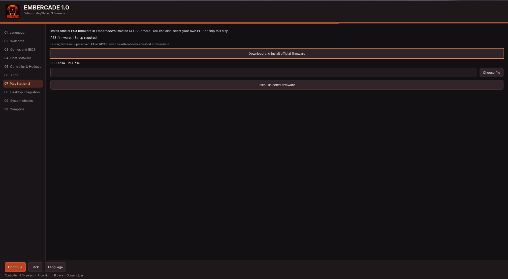](images/getting-started/ps3-firmware.png)

PS3 emulation requires compatible official firmware.

The wizard can help you install the official PS3 firmware through the supported RPCS3 setup, or you can select an appropriate firmware file you already have.

You don't need to complete these optional system-specific steps to use Embercade for other platforms.

Click **Continue**.

## 11. Desktop and Steam integration

[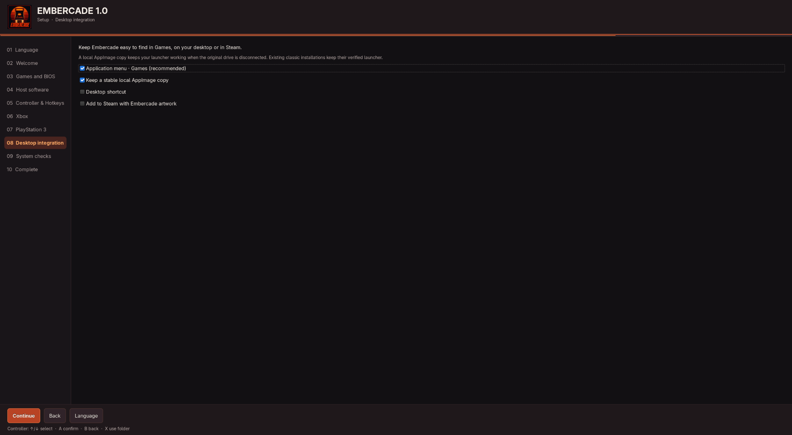](images/getting-started/desktop-integration.png)

This page controls how you'll launch Embercade in the future.

You can select:

**Application menu**

Adds Embercade to your desktop's application menu.

**Keep a stable local AppImage copy**

Keeps an application copy at a permanent local location, so moving or disconnecting the original download won't break the shortcut.

**Desktop shortcut**

Creates an additional desktop shortcut if you prefer one.

**Add to Steam**

Optionally adds Embercade to your Steam library with matching artwork.

Close Steam completely before applying Steam integration changes.

For most desktop users, keeping the application-menu entry and stable local copy enabled is a sensible choice.

Click **Continue**.

## 12. Review your setup

[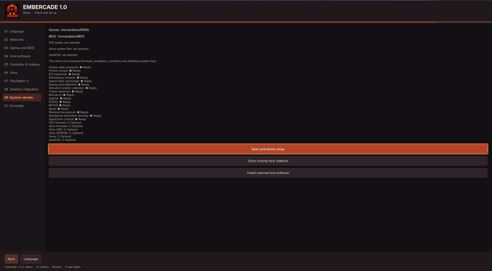](images/getting-started/system-checks.png)

Before finishing, Embercade shows your selected folders and checks the available system components.

Click **Save and check setup**.

Embercade checks the configuration, software and additional system requirements.

Don't worry if optional systems such as Xbox, PSP or PlayStation 3 still show missing files. They can be configured later.

If something required for your setup is missing, the wizard will tell you what needs attention.

## 13. Start Embercade!

[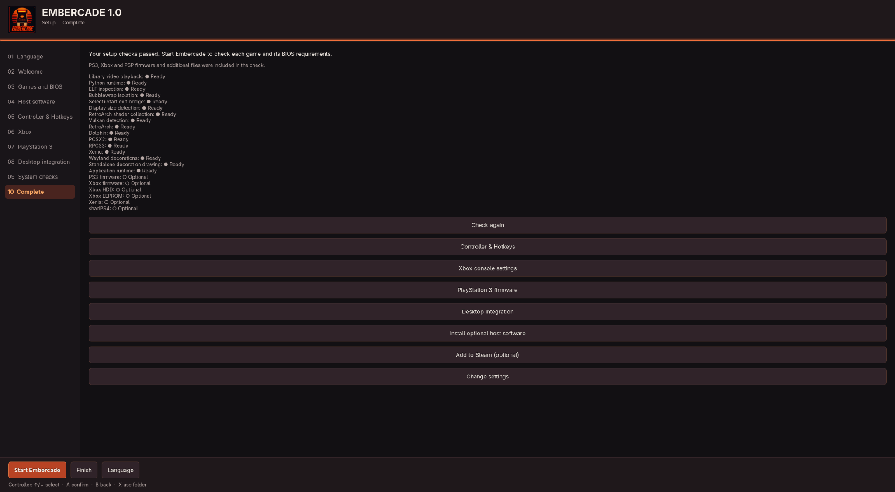](images/getting-started/setup-complete.png)

**Setup complete! 🎉**

Review the result shown by the wizard. It distinguishes a complete setup from components that still need attention.

You can now click **Start Embercade** to open your game library.

Optional systems may need additional files or configuration before their games can start. You can return to those settings later.

Enjoy your games!

The screenshots show an isolated demonstration profile with empty example folders. Cosmetic wording can differ slightly from the final v1.0.1 build.

---

# After your first start

## Add artwork and videos with ScreenScraper

Embercade integrates ScreenScraper directly into EmulationStation.

You can use it to download game descriptions, cover artwork, screenshots, videos and other metadata.

If you already have a compatible RetroBat or Batocera collection, existing metadata and media can be reused where their paths are valid.

For additional ScreenScraper features, configure your own ScreenScraper account in the frontend.

[More about ScreenScraper](SCREENSCRAPER.md)

## Enable RetroAchievements

Want to earn achievements while playing supported classic games?

Open **Game Settings → RetroAchievements Settings** and sign in with your RetroAchievements account.

Achievements in supported emulators use your normal player login.

If you also want to view your profile, achievement lists and progress inside Embercade's frontend, you can enter your own optional **Personal Web API key**.

You can obtain your key from your RetroAchievements account control panel.

[RetroAchievements setup](RETROACHIEVEMENTS_USER_KEYS.md)

## Change your theme

Embercade includes **Carbon** by default.

You can use the built-in Theme Downloader to discover and install additional community themes.

The **AI-Hypertocera** theme shown in many of our GitHub screenshots is available there as an optional download.

Other themes, console decorations and compatible shaders can also be selected through the frontend.

---

# Updating Embercade

Embercade doesn't currently download application updates automatically.

To update:

1. Close Embercade completely.
2. Download the new AppImage from the official GitHub releases page.
3. Make the new AppImage executable if needed.
4. Replace your previous application copy, or configure the new stable location using Embercade's setup options.

Keep your previous working AppImage until you've confirmed the update runs correctly.

Your normal Embercade configuration, saved games, downloaded themes and managed user data are stored separately from the AppImage and are preserved by normal updates.

If you use a Steam or desktop shortcut, make sure it points to the updated application location.

---

# Having trouble?

**The AppImage doesn't start**

Check that the file is executable. Also verify that your system has the required Python 3.14 runtime and compatible host libraries.

**Embercade can't find my games**

Check the folder you selected during setup. Make sure the drive is connected, your user can access the files, and the game folders follow supported system names.

**A game won't start**

The required emulator, core or BIOS might be missing. Open Embercade's system checks to see what is available. Not every game or emulator is supported on every computer.

**PSP, Xbox or PS3 shows missing files**

These systems have additional requirements. You can leave them unconfigured until you're ready to use them.

**My console bezel doesn't fit the screen**

Some 16:9 decorations don't align correctly on 16:10 displays. This is a known limitation. You can choose **Decoration → None** to disable the bezel.

For more technical help, see the [AppImage documentation](APPIMAGE.md), [controller guide](CONTROLLER_SETUP.md) and [compatibility notes](COMPATIBILITY_1_0.md).

---

# Optional: Using the terminal

If you prefer the terminal, you can also make the AppImage executable and start it with commands.

Open a terminal in the folder containing your downloaded AppImage:

```bash
chmod +x Embercade-*.AppImage
./Embercade-*.AppImage
```

These commands assume there is only one matching Embercade AppImage in that folder. If you've downloaded several versions, use the exact filename of the one you want to run.

To run Embercade's built-in diagnostic check, use the AppImage's `doctor` command:

```bash
./Embercade-*.AppImage doctor
```

For checkout installation, checksum verification, CLI diagnostics, updates, removal and development checks, see [Advanced usage](ADVANCED_USAGE.md).

---

**Need help or found a bug?**

You can [open an issue on GitHub](https://github.com/RetroGamerGER/Embercade/issues) and describe what happened.

Please include your Linux distribution, what you were trying to do and any error message you received. Never include passwords or API keys in a bug report.

**Have fun with Embercade! 🎮🐧**
